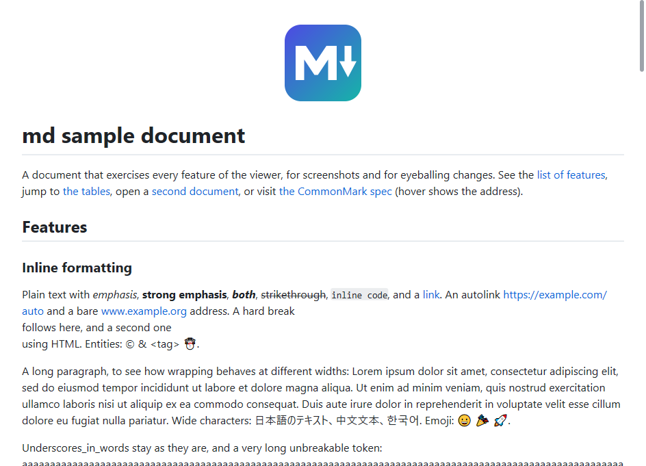

# md

A small and self-contained Markdown viewer without any fuss.

`md` is a single 215 KB executable that needs only DLLs every Windows install
has. There's no runtime or browser engine inside it. Text goes straight to
DirectWrite, the same text engine Windows itself uses, so it opens in a
fraction of a second.

## What it shows

Everything in CommonMark 0.31.2, plus GitHub's tables, task lists,
strikethrough and bare links.

Code blocks are highlighted for C, C++, C#, Java, Rust, Go, JavaScript,
TypeScript, JSON, Python, shell, PowerShell, Makefiles, CMake, TOML, YAML, INI,
diffs, HTML/XML and SQL.

Tables are sized to their contents and wrap when the window is narrow.

Images can be PNG, JPEG, GIF (animated too), BMP, TIFF, ICO, or WebP if Windows
has the WebP codec, which recent versions do. Paths are relative to the
document. Raw HTML is reduced to what READMEs actually use: ` `, ``
with its width and height, `<a href>` and `align="center"`. Other tags are
dropped and their text kept.

Links to web pages open in your browser, `#heading` links scroll to the
heading, and links to other Markdown files open in md, with back and forward.
Hovering a link shows where it goes.

The theme follows the operating system's light or dark setting. Documents
auto-reload when the file changes on disk, keeping your place.

## Build

Needs `gcc`, `make` and `windres`. Available in [w64devkit][].

    make                 # md.exe
    make debug           # md-debug.exe: debug info, UBSan traps, guard pages
    make test            # build and run the tests
    make clean

Or with Visual Studio or its Build Tools, from any console:

    build                # md.exe
    build debug          # md-debug.exe: a PDB, guard pages
    build test
    build clean

Every build writes the programs next to the sources, and its other files to
`obj/`. Set `OUT` to build somewhere else, as in `OUT=gcc make` or
`set OUT=msvc` then `build`.

## Usage

    md [FILE]

Open a file from the command line, with Ctrl+O, or by dropping it on the
window.

| Keys | |
|---|---|
| Arrows, PgUp, PgDn, Space, Shift+Space, Home, End | scroll |
| Ctrl+wheel, Ctrl+Plus, Ctrl+Minus, Ctrl+0 | zoom |
| Alt+Left, Backspace, Alt+Right | back and forward between linked documents |
| F5, Ctrl+R | reload |
| Ctrl+A, Ctrl+C | select all, copy |
| Ctrl+F, F3, Shift+F3, Enter, Shift+Enter | find, next and previous match |
| Escape | close find, clear the selection |

Drag to select text, double-click for a word and triple-click for a
paragraph. Copying gives the text as shown, not the Markdown: list markers
and quote marks are kept, code blocks are copied as they are and tables
become tab-separated rows.

Find searches as you type, ignoring case, and highlights every match.

## Layout

    md.c         Markdown parser: CommonMark and GitHub's extensions
    highlight.c  syntax highlighting for code blocks
    layout.c     block layout: paragraphs, lists, tables, code
    view.c       the viewer: scrolling, links, selection, find
    platform.h   everything the code above asks of the operating system
    main.c       Windows: window, input, clipboard, files
    gfx.c        Windows: text and drawing with DirectWrite and Direct2D
    image.c      Windows: image decoding with WIC
    win32.c      hand-written Win32 and COM declarations
    base.c       types, arena, strings, UTF conversion

`md` is a unity build: main.c includes the other files. Only main.c, gfx.c,
image.c and win32.c know about Windows. The rest of the code talks to the
operating system through the platform.h API. Porting to a new OS largely
means wiring in the new target to platform.h.

## Testing

    make test
    make comcheck

The parser passes all 652 CommonMark spec examples and GitHub's extension
examples. `md` is also fed random documents and inputs built to make parsers
slow, such as deep nesting and long runs of brackets and asterisks, and must
handle each in linear time. The highlighter gets the same treatment for every
language.

## License

Public domain. See [UNLICENSE](UNLICENSE).

[w64devkit]: https://github.com/skeeto/w64devkit
